# PeraBots 2026 · Maze-solving robot (Team DATALABS)

Webots controller for the PeraBots 2026 Phase 1 task. A two-wheel robot crosses an obstacle field (Section 1), enters a 4 × 9 maze (Section 2), finds every blue and green tile, drives to the end cell and lights the LED of the majority colour.

## Results at a glance

| | |
|---|---|
| **Test runs passed** | **42 / 42** (21 arenas × full run + Section 2-only run) |
| **Official arena, full run** | **117.1 s** (Section 1: 20.1 s, maze: 96.3 s), all 5 tiles, green LED ✅ |
| **Official arena, Section 2 attempt** | **99.4 s**, all 5 tiles, green LED ✅ |
| Correct LED / all tiles found | 42 / 42 runs |
| Collisions | 0 in every run |
| End-cell margin (whole body inside) | 7.2 – 8.2 cm |
| Longest standstill | 3.7 s (rule limit 15 s) |
| Max tilt | 0.0° |
| vs. previous algorithm | 38 / 42 → **42 / 42** passed; −27 % total time (3163 s → 2310 s over the full runs the old version could finish) |

<p align="center">
  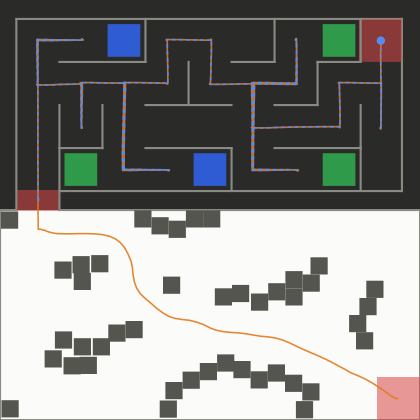<br>
  <sub>Official arena: the robot's true path measured by the test supervisor. Orange = full run from the start zone, blue dashed = Section 2-only attempt. Blue and green squares are the tiles; red = start, transition and end markers.<br>
  ▶ Videos: <a href="testing/test_tools/videos/test_j_OFF.mp4">full run</a> · <a href="testing/test_tools/videos/test_j_OFF_s2.mp4">Section 2 attempt</a></sub>
</p>

Contents: [Repository layout](#repository-layout) · [How the controller works](#how-the-controller-works) · [Test suite and results](#test-suite-and-results) · [Running the tests](#running-the-tests)

## Repository layout

```
controllers/main_controller/   the controller (this is what gets submitted)
protos/  worlds/               robot, arena and the official Arena.wbt
docs/
  paths/*.svg                  true robot path in every test arena (used below)
  PeraBots_Lean_Sensor_Architecture.md   sensor design notes
  TEAMDATALABS_Report.html     full team report (open in a browser)
PHASE1_PLAN.md                 original plan
testing/                       TEST ONLY, not part of the submission
  test_run/                    Webots project with the 42 test worlds and arena protos
  test_tools/
    run_advanced.py            runs worlds in Webots (window shown by default)
    test_judge/                supervisor that scores each run against the rulebook
    make_report.py             builds REPORT.md / report.html from the results
    export_svgs.py             exports docs/paths/*.svg
    gen_*.py, maze_sim.py      world generators and offline maze simulator
    video_results/             latest results: <world>.json (judge) + <world>.log (robot)
                               + REPORT.md and report.html (full per-arena details)
    videos/                    MP4 recording of each of the 42 runs
    suite_results_old/         same suite run with the previous algorithm (for comparison)
```

The submission zip contains only `controllers/`, `protos/` and `worlds/`. Leave `testing/` and `docs/` out of it.

---

# How the controller works

This section explains the code in `controllers/main_controller/`: what each file does, how a run flows from start to finish, and which settings in `config.py` you can tune.

## 1. Files

| File | Job |
|---|---|
| `main_controller.py` | Entry point. Works out where the robot was placed, then runs Section 1, the transition and Section 2 in order. |
| `config.py` | Every constant: robot geometry, sensor poses, speeds, gains, arena coordinates, thresholds. |
| `hardware.py` | `Bot` class. Sets up all devices and runs `step()`, which advances the simulation, reads the sensors, updates the pose and calls listeners. |
| `odometry.py` | Pose estimate (x, y, θ) from the wheel encoders plus the IMU heading. |
| `motion.py` | Motion primitives: `turn_to`, `drive_to`, `drive_axis`, `drive_cells`, `back_off`, `stop`, `halt`. |
| `vision.py` | Camera floor-colour classification (`near` and `ahead` regions). |
| `section1.py` | Obstacle field: occupancy grid, A* planner, path following, fallbacks. |
| `section2.py` | Maze: wall map, exploration, tile counting, majority vote, drive to the end cell, LED. |
| `watchdog.py` | Anti-termination: stuck detection (`Watchdog`) and repeated-failure detection (`LoopGuard`). |

How the modules depend on each other:

```
main_controller ──► section1 ──┐
       │         └► section2 ──┼──► hardware.Bot ──► motion.Motion ──► odometry
       └──────────► vision ◄───┘         │
                                          └──► config (everything reads config)
section1/section2 ──► watchdog
```

---

## 2. The robot

- Base: the provided `TwoWheelRobot.proto`. Wheel radius 0.02 m, track width 0.064 m, caster at the back.
- **Wheels moved 0.8 cm forward** (`AXLE_X = 0.008`). This puts the centre of mass slightly behind the axle, so the robot rests on its caster and doesn't tip onto its nose when braking.
- Sensors in `extensionSlot`:
  - **12 distance sensors** at z = 0.045 m. They return metres, and 1.0 means nothing was detected.
    - `ds_f` (0°), `ds_fl20` / `ds_fr20` (±20°), `ds_fl45` / `ds_fr45` (±45°), `ds_fl70` / `ds_fr70` (±70°)
    - `ds_l` / `ds_r` (±90°), `ds_bl` / `ds_br` (±135°), `ds_b` (180°)
  - **InertialUnit** `imu`: absolute yaw.
  - **Camera** `cam`: 32 × 24 pixels, pitched 0.6 rad down, sees the floor ahead.
- LEDs `led_blue` and `led_green` are switched **off** at startup and only ever used for the final answer.

---

## 3. The control loop: `Bot.step()`

Everything moves the simulation forward through `bot.step()`. There is no other `robot.step()` call except inside `finish()`. Each step:

1. Calls `robot.step(16 ms)`. If Webots ends the simulation, the controller exits.
2. Reads all distance sensors into `bot.d[name]`.
3. Updates odometry from the encoders and the IMU yaw.
4. Calls every function in `bot.listeners`. Examples: the Section 1 map update, and the Section 2 correction that keeps the robot centred between walls.

This means every motion primitive also keeps mapping and localisation running.

Motors use **velocity control** (`setPosition(inf)`) with an **acceleration limit** of 40 rad/s² (`WHEEL_ACCEL`). The limit keeps the wheels from slipping and the robot from tipping.

---

## 4. Localisation (no GPS)

`odometry.py`

- **Heading θ** = IMU yaw (absolute, no drift).
- **Distance** = mean of the left and right encoder changes × wheel radius.
- **Position** = integrated along the average heading over each step. Because the axle sits `AXLE_X` ahead of the chassis centre, the code moves the axle point and then converts back to the chassis centre. The pose is always the chassis centre.

Absolute corrections, using only **fixed arena features and walls**:

| Where | Correction |
|---|---|
| Start zone | Face −x. The back sensor measures the right arena wall to fix x; the left sensor measures the bottom wall to fix y. |
| Below the gap (end of Section 1) | Face −x. The front sensor measures the left arena wall to fix x (`fix_x_at_gap`). |
| Driving in the maze (listener) | Side walls at a known distance correct the position across the corridor (`lateral_listener`). |
| Stopped at a cell centre | Front, back and side walls snap x and y to the cell centre (`snap`). |
| Approaching a front wall | `drive_axis` measures the remaining distance with `ds_f` and stops exactly at the cell centre. |

In tests, odometry stayed within about 1–3 cm of the true position.

---

## 5. Program flow

```
main()
 ├─ Bot()                      set up devices, LEDs off, prime sensors
 ├─ detect_start()             where am I?
 │    ├─ open space around     → 'S1'  (start zone, set pose from the corner walls)
 │    └─ narrow corridor       → 'S2'  (judges placed the robot at the maze entrance)
 ├─ if S1:
 │    ├─ section1.run()        obstacle field → point below the gap (0.22, 1.12)
 │    └─ fix_x_at_gap()        re-measure x against the left wall, line up again
 ├─ enter_maze()               face north, drive through the red chamber into cell (1,1)
 └─ section2.run()             explore → count tiles → go to end cell → LED → stop forever
```

### 5.1 `detect_start`
1. Turn to the nearest grid direction.
2. If the left + right readings and the front + back readings are both ≥ 0.30 m, the robot is in open space. That means the **start zone**, so it faces −x and measures its pose against the bottom-right corner walls.
3. Otherwise it's in a narrow corridor, so this is a **Section 2 attempt**. It faces south and looks at the floor behind with the camera:
   - white or red floor → it's on the transition tile, pose (0.22, 1.275)
   - otherwise → it's already in cell (1,1)

---

## 6. Section 1: obstacle field (`section1.py`)

### Occupancy grid
- 2.5 cm cells covering 2.44 × 1.22 m (98 × 49 cells). The outer walls are marked as fixed, except for the gap in the top wall (x 0.101–0.339).
- **Every step**, each distance sensor ray:
  - lowers the "occupied" score of the cells it passes through (clears free space, up to 0.6 m), and
  - raises the score of the cell where it hits something (hits within 0.9 m only).
- A **distance field** stores how far each cell is from the nearest obstacle. It's updated incrementally for new hits and fully recomputed when a cell gets cleared.

### Cost of a cell (keeps the robot in the middle of passages)
| Distance to obstacle | Cost |
|---|---|
| < 4.5 cm (`R_FORBID`) | forbidden |
| < 7 cm (`R_HARD`) | +25 |
| < 13 cm (`R_SOFT`) | +0 to 2.5, sliding scale |
| otherwise | 1 |

### Planning and following
- **A*** with 8-connected moves (diagonals cost √2) from the robot to the goal (0.22, 1.12). Unknown cells count as free, so the robot heads straight for the goal and bends around cubes as it discovers them.
- Re-plans when the map changes (at most every 0.3 s), and at least every 1.5 s.
- **Pure-pursuit following:** aim at the path point 10 cm ahead. If the heading error is more than about 50°, spin in place; otherwise drive with a proportional heading correction and slow down near the goal.
- Finishes when within 3.5 cm of the goal.

### Safety and fallbacks
| Situation | Reaction |
|---|---|
| A front sensor reads < 3.5 cm | Back off and re-plan |
| No A* path (1st time) | Clear map memory within 20 cm of the robot, then re-plan |
| No A* path again | `reactive()`: head for the goal and turn away from obstacles for 2 s, then re-plan |
| Moved < 2 cm in 3 s (`Watchdog`) | Back off and re-plan |

---

## 7. Transition to the maze

`enter_maze()` faces north (+y) and uses `drive_axis` to reach the centre of cell (1,1) at (0.22, 1.455). As soon as the robot is inside the chamber, the side-wall correction keeps it centred.

---

## 8. Section 2: maze (`section2.py`)

### Grid and map
- 4 rows × 9 columns, 25 cm cells. Row r grows with +y, column c grows with +x.
  Cell centre = (0.22 + 0.25·(c−1), 1.455 + 0.25·(r−1)).
- Directions `N E S W` = headings 90°, 0°, −90°, 180°.
- `Maze.walls`: each wall between two cells is stored **once** (shared by both cells). Values are `True` (wall), `False` (open) or missing (unknown). The outer boundary always counts as a wall.
- `Maze.tile[cell]` = `'blue'`, `'green'` or `'none'` (floor seen, no tile).
- `Maze.visited` = cells the robot has stood in.

### At every stop: `sense()`
1. Stop and settle, then `snap()` the pose to the cell centre using the walls it can see.
2. **Look along all four directions** (`peek`) with the front, back, left and right sensors. A reading tells how many cells away the next wall is:
   `k = (reading − (0.119 − sensor_offset)) / 0.25`, rounded. Edges before cell k are marked open, and the wall at k is marked as a wall. So one stop can map walls several cells away.
3. Camera `near` → tile under or just ahead of the robot, stored for the current cell.
4. Camera `ahead` (only if the edge in front is open) → tile in the **next** cell.
5. **Dead-end peeking:** if a neighbouring cell is a known dead end (3 walls) that hasn't been checked, turn toward it and read its tile with the camera instead of driving in.

**Target choice** (`pick_target`), in order: a known dead end right beside the robot is glanced into first (one turn, no round trip); otherwise the target chosen at the previous stop is kept while it is still unresolved and reachable (so two near-equal tours can't alternate forever); otherwise the tour order. A cell where the camera saw a blue/green tile from the neighbouring cell counts as resolved and is sealed as a dead end (tiles only lie in dead ends), so the robot doesn't drive into it while exploring.

### Exploration loop
```
repeat (max 200 stops):
    sense()
    peek into known dead ends next to us
    (optional EARLY_STOP: quit if |blue − green| > cells still unresolved)
    plan to the cheapest cell that is not resolved (and not banned)
    if there is none: exploration finished
    drive the FIRST straight run of that path
```
- A cell is **resolved** when it has been visited, or all its walls are known and either it isn't a dead end or its tile is known. Only dead ends can hold tiles.
- **Planner:** Dijkstra over (cell, heading) states, with a cost of 1 per cell move and 0.35 per 90° turn. So it prefers straight runs. The end cell is avoided during exploration.
- **Driving:** `Navigator.run()` turns to the run's direction, checks for an unexpected wall, looks ahead with the camera, then `drive_axis` to the end of the run. If the run is blocked or times out, the robot re-localises to the nearest cell, records the wall and returns to that cell's centre.
- **LoopGuard:** if runs toward the same target fail more than 3 times in a row, that target is skipped for 30 s.

### Majority decision
```
blue  = number of 'blue' tiles
green = number of 'green' tiles
majority = 'blue' if blue > green, 'green' if green > blue, TIE_COLOUR if equal
```

### Going to the end cell
- Plan to `END_CELL` (4,9), allowing unknown edges (they cost 1.5 instead of 1), and drive run by run, re-sensing after each run.
- When the robot is inside the end cell, `bot.finish(colour)` runs.

### Finish
`finish()` sets both wheels to 0, switches on **only** the majority LED, and then keeps stepping forever. The LED comes on immediately on arrival, well inside the 3 s limit.

---

## 9. Vision (`vision.py`)

- `classify(r, g, b)` works on ratios, so it's robust to lighting:
  - black: max < 45
  - white: min > 150
  - red: r > 80 and r > 2g and r > 2b
  - green: g > 45 and g > 1.6r and g > 1.3b
  - blue: b > 35 and b > 1.6r and b > 1.3g
- `region_colour` votes over a band of rows, using only the centre half of the columns. It returns the winner only if it has at least 40% of the pixels.
  - `near` = rows 16–23 → floor of the current cell, just ahead
  - `ahead` = rows 1–8 → floor of the next cell (about 13–30 cm ahead)
- `stable(fn, frames)` reads over 2–3 frames and accepts a colour only if every frame agrees.
- Tiles are stored per cell, so the same tile is never counted twice.

---

## 10. Watchdog and anti-termination (`watchdog.py`)

The rulebook ends an attempt after 15 s without progress. The controller reacts much earlier:
- `Watchdog.stuck()`: keeps the pose history over 3 s. Moving less than 2 cm counts as stuck, and spinning on the spot doesn't count as progress.
- `LoopGuard`: temporarily bans a target that keeps failing.
- Every `drive_axis` and `turn_to` call has a timeout, so no single move can hang.

---

## 11. Tuning guide (`config.py`)

| Setting | Default | Effect |
|---|---|---|
| `S1_CRUISE`, `S2_CRUISE` | 8.0 rad/s | Driving speed (0.16 m/s). Higher is faster but riskier. |
| `WHEEL_ACCEL` | 40 rad/s² | Lower is smoother and less slip; higher reacts faster. |
| `S2_KNOWN` | 10.0 rad/s | Maze runs of 2+ cells over cells already driven through (0.20 m/s, the motor maximum). |
| `DRIVE_DECEL` | 0.5 m/s² | `drive_axis` braking: full speed until ~4 cm before the stop, then constant deceleration. |
| `TURN_K`, `TURN_MAX`, `TURN_TOL` | 9, 6, 1.2° | Turn gain (Section 1 path following), max turn wheel speed, turn tolerance. |
| `TURN_DECEL`, `TURN_K_END` | 15 rad/s², 20 | `turn_to`: brakes at a constant angular deceleration, then a stiff P term for the last ~10°. |
| `HEAD_K`, `CROSS_K` | 7, 5 | Heading and line-keeping gains while driving. |
| `R_FORBID` / `R_HARD` / `R_SOFT` | 4.5 / 7 / 13 cm | How far Section 1 paths stay from cubes. |
| `S1_GOAL`, `S1_GOAL_TOL` | (0.22, 1.12), 3.5 cm | Target below the gap. |
| `WALL_THRESH_F/S` | 0.20 m | Axis-sensor reading below this means a wall in this cell. |
| `CAM_AHEAD_ROWS`, `CAM_NEAR_ROWS` | 1–8, 16–23 | Camera bands; retune if the camera pose changes. |
| `EARLY_STOP` | False | True = stop exploring once the majority is decided (shorter, but check the scoring rules). |
| `TIE_COLOUR` | 'blue' | Used if blue = green (not defined in the rulebook). |
| `TURN_COST` | 0.35 cells | Higher means maze routes prefer fewer turns. |
| `STUCK_WINDOW`, `STUCK_MOVE` | 3 s, 2 cm | Stuck-detection sensitivity. |
| `DEBUG` | True | Print progress to the Webots console. |

Set the environment variable `PERABOT_LOG=<file>` to also write the log to a file. When it isn't set, this does nothing.

---

# Test suite and results

## Setup

- **Simulator:** Webots R2025a with the window and 3D rendering shown, fast mode. Every run was recorded to MP4. Runs are deterministic: the same world gives the same times (within 0.05 s) whether rendered or hidden, real time or fast.
- **Arenas:** 21 test arenas. The outline, the 4 × 9 maze grid (25 cm cells), wall size and markers are all identical to `Arena.proto`. Only the internal maze walls, the tiles and the Section 1 obstacles change.
- **Two runs per arena:**
  - **full:** start zone → Section 1 → maze
  - **Section 2 only:** a dedicated Section 2 attempt, with the robot placed on the transition tile
- **Judge:** a supervisor (`testing/test_tools/test_judge/test_judge.py`) records the true pose every step and scores the run. A run **PASSES** when it finishes with the correct LED, has its whole body inside the end cell, never enters the end cell early, never goes 15 s without progress and stays still after the LED. Missed tiles and collisions are reported too.
- **Algorithm under test:** the current `controllers/main_controller` on `main`.

## Test arenas

| ID | Name | What it tests | Dead ends | Tiles (B / G) | Expected LED |
|---|---|---|---|---|---|
| OFF | Official arena | the provided Arena.wbt layout (Arena.proto + Obstacles.proto) | 8 | 2 / 3 | green |
| D1 | Snake | one long serpentine path; pockets right beside the end cell | 4 | 1 / 2 | green |
| D2 | Open hall | few walls, wide open areas (few walls to localise on), 5 alcove tiles | 5 | 2 / 3 | green |
| D3 | Comb | 16 dead ends off one corridor, 7 tiles, close 4:3 majority | 16 | 4 / 3 | blue |
| D4 | Deep branches | tiles at the far ends of long corridors (camera sees 1 cell ahead) | 4 | 1 / 2 | green |
| D5 | Loops | many loops and equal-length routes; 3 alcove tiles | 5 | 1 / 2 | green |
| R1 | Random 1 | random DFS maze + 3 loops, random tiles and obstacle clusters (gen_random_world.py seed 1) | 5 | 1 / 2 | green |
| R2 | Random 2 | random DFS maze + 3 loops, random tiles and obstacle clusters (gen_random_world.py seed 2) | 2 | 0 / 1 | green |
| R3 | Random 3 | random DFS maze + 3 loops, random tiles and obstacle clusters (gen_random_world.py seed 3) | 3 | 0 / 1 | green |
| A1 | Staircase | zig-zag staircase: a 90-degree turn after nearly every cell; stair-shaped side branches | 7 | 2 / 3 | green |
| A2 | Nine tiles | 12 dead ends, 9 tiles, 5:4 majority; dead ends hidden behind walls next to the main corridor | 12 | 4 / 5 | green |
| A3 | Long corridors | four parallel 2 m corridors with featureless walls; dead ends out of sensor range, one right beside the end cell | 3 | 1 / 2 | green |
| A4 | Islands | free-standing wall islands, loops everywhere, open areas with no side walls; only 3 dead ends (boundary alcoves) | 3 | 2 / 1 | blue |
| A5 | Behind the end | 6 cells (2 empty dead ends) reachable only THROUGH the end cell; exploration must give up on them and still finish | 7 | 3 / 2 | blue |
| A6 | Rooms | open 2x2 / 2x3 rooms (no walls inside) joined by single doorways, tiles in closets, two empty closets in the end room | 7 | 2 / 3 | green |
| A7 | Ladder | two 9-cell rails joined by 5 rungs (many loops), 16 dead-end pockets beside the rails, 7 tiles 4:3 | 16 | 3 / 4 | green |
| A8 | Spiral | 24-cell spiral dead end, the single tile at its centre right beside the end cell (behind a wall) | 1 | 1 / 0 | blue |
| A9 | Hard perfect 1 | no loops; the deepest / most branched of 3000 random perfect mazes (seed 969), 7 dead ends, 7 tiles | 7 | 4 / 3 | blue |
| A10 | Hard perfect 2 | no loops; the deepest / most branched of 3000 random perfect mazes (seed 2463), 7 dead ends, 7 tiles | 7 | 3 / 4 | green |
| A11 | Braided 1 | random maze (seed 0) braided into 7 loops: open areas, many equal-cost routes (the A4 livelock pattern), only 3 dead ends | 3 | 2 / 1 | blue |
| A12 | Braided 2 | random maze (seed 10) braided into 6 loops: open areas, many equal-cost routes (the A4 livelock pattern), only 3 dead ends | 3 | 1 / 2 | green |

## All 42 runs

**42 / 42 passed.** Each row links to the run's video. The judge's raw data for each run is in `testing/test_tools/video_results/<world>.json`, and the robot's own log is in `<world>.log`.

| Arena | Run | Verdict | LED (expected) | Finish (s) | Maze (s) | Distance (m) | Tiles found / true | Cell moves (re-driven) | End-cell margin | Collisions | Video |
|---|---|---|---|---|---|---|---|---|---|---|---|
| OFF Official arena | full | ✅ PASS | green (green) | 117.1 | 96.3 | 13.1 | B2 G3 / B2 G3 | 39 (13) | 7.9 cm | 0 | [▶ mp4](testing/test_tools/videos/test_j_OFF.mp4) |
| OFF Official arena | Section 2 only | ✅ PASS | green (green) | 99.4 | 96.5 | 10.5 | B2 G3 / B2 G3 | 39 (13) | 7.9 cm | 0 | [▶ mp4](testing/test_tools/videos/test_j_OFF_s2.mp4) |
| D1 Snake | full | ✅ PASS | green (green) | 109.0 | 88.8 | 13.3 | B1 G2 / B1 G2 | 41 (8) | 8.2 cm | 0 | [▶ mp4](testing/test_tools/videos/test_j_D1.mp4) |
| D1 Snake | Section 2 only | ✅ PASS | green (green) | 91.7 | 88.8 | 10.8 | B1 G2 / B1 G2 | 41 (8) | 8.2 cm | 0 | [▶ mp4](testing/test_tools/videos/test_j_D1_s2.mp4) |
| D2 Open hall | full | ✅ PASS | green (green) | 104.2 | 84.2 | 12.4 | B2 G3 / B2 G3 | 37 (11) | 7.7 cm | 0 | [▶ mp4](testing/test_tools/videos/test_j_D2.mp4) |
| D2 Open hall | Section 2 only | ✅ PASS | green (green) | 86.9 | 84.0 | 9.9 | B2 G3 / B2 G3 | 37 (11) | 7.7 cm | 0 | [▶ mp4](testing/test_tools/videos/test_j_D2_s2.mp4) |
| D3 Comb | full | ✅ PASS | blue (blue) | 150.2 | 130.2 | 17.3 | B4 G3 / B4 G3 | 55 (25) | 8.2 cm | 0 | [▶ mp4](testing/test_tools/videos/test_j_D3.mp4) |
| D3 Comb | Section 2 only | ✅ PASS | blue (blue) | 133.0 | 130.1 | 14.8 | B4 G3 / B4 G3 | 55 (25) | 8.2 cm | 0 | [▶ mp4](testing/test_tools/videos/test_j_D3_s2.mp4) |
| D4 Deep branches | full | ✅ PASS | green (green) | 133.9 | 113.8 | 17.4 | B1 G2 / B1 G2 | 57 (25) | 8.2 cm | 0 | [▶ mp4](testing/test_tools/videos/test_j_D4.mp4) |
| D4 Deep branches | Section 2 only | ✅ PASS | green (green) | 116.6 | 113.8 | 14.9 | B1 G2 / B1 G2 | 57 (25) | 8.2 cm | 0 | [▶ mp4](testing/test_tools/videos/test_j_D4_s2.mp4) |
| D5 Loops | full | ✅ PASS | green (green) | 114.2 | 94.2 | 13.8 | B1 G2 / B1 G2 | 43 (13) | 7.7 cm | 0 | [▶ mp4](testing/test_tools/videos/test_j_D5.mp4) |
| D5 Loops | Section 2 only | ✅ PASS | green (green) | 97.4 | 94.6 | 11.4 | B1 G2 / B1 G2 | 43 (13) | 7.7 cm | 0 | [▶ mp4](testing/test_tools/videos/test_j_D5_s2.mp4) |
| R1 Random 1 | full | ✅ PASS | green (green) | 117.6 | 97.5 | 13.5 | B1 G2 / B1 G2 | 41 (11) | 7.2 cm | 0 | [▶ mp4](testing/test_tools/videos/test_j_R1.mp4) |
| R1 Random 1 | Section 2 only | ✅ PASS | green (green) | 100.3 | 97.5 | 10.9 | B1 G2 / B1 G2 | 41 (11) | 7.2 cm | 0 | [▶ mp4](testing/test_tools/videos/test_j_R1_s2.mp4) |
| R2 Random 2 | full | ✅ PASS | green (green) | 96.0 | 76.0 | 11.2 | B0 G1 / B0 G1 | 33 (1) | 7.2 cm | 0 | [▶ mp4](testing/test_tools/videos/test_j_R2.mp4) |
| R2 Random 2 | Section 2 only | ✅ PASS | green (green) | 78.7 | 75.9 | 8.8 | B0 G1 / B0 G1 | 33 (1) | 7.2 cm | 0 | [▶ mp4](testing/test_tools/videos/test_j_R2_s2.mp4) |
| R3 Random 3 | full | ✅ PASS | green (green) | 95.5 | 75.5 | 11.3 | B0 G1 / B0 G1 | 33 (2) | 7.2 cm | 0 | [▶ mp4](testing/test_tools/videos/test_j_R3.mp4) |
| R3 Random 3 | Section 2 only | ✅ PASS | green (green) | 78.2 | 75.4 | 8.8 | B0 G1 / B0 G1 | 33 (2) | 7.2 cm | 0 | [▶ mp4](testing/test_tools/videos/test_j_R3_s2.mp4) |
| A1 Staircase | full | ✅ PASS | green (green) | 179.0 | 158.9 | 19.8 | B2 G3 / B2 G3 | 65 (36) | 8.0 cm | 0 | [▶ mp4](testing/test_tools/videos/test_j_A1.mp4) |
| A1 Staircase | Section 2 only | ✅ PASS | green (green) | 161.8 | 158.9 | 17.3 | B2 G3 / B2 G3 | 65 (36) | 8.0 cm | 0 | [▶ mp4](testing/test_tools/videos/test_j_A1_s2.mp4) |
| A2 Nine tiles | full | ✅ PASS | green (green) | 149.3 | 129.3 | 18.1 | B4 G5 / B4 G5 | 59 (33) | 8.2 cm | 0 | [▶ mp4](testing/test_tools/videos/test_j_A2.mp4) |
| A2 Nine tiles | Section 2 only | ✅ PASS | green (green) | 132.5 | 129.6 | 15.6 | B4 G5 / B4 G5 | 59 (33) | 8.2 cm | 0 | [▶ mp4](testing/test_tools/videos/test_j_A2_s2.mp4) |
| A3 Long corridors | full | ✅ PASS | green (green) | 128.6 | 108.6 | 17.8 | B1 G2 / B1 G2 | 59 (27) | 7.2 cm | 0 | [▶ mp4](testing/test_tools/videos/test_j_A3.mp4) |
| A3 Long corridors | Section 2 only | ✅ PASS | green (green) | 111.8 | 109.0 | 15.3 | B1 G2 / B1 G2 | 59 (27) | 7.2 cm | 0 | [▶ mp4](testing/test_tools/videos/test_j_A3_s2.mp4) |
| A4 Islands | full | ✅ PASS | blue (blue) | 114.2 | 94.2 | 12.9 | B2 G1 / B2 G1 | 39 (12) | 7.2 cm | 0 | [▶ mp4](testing/test_tools/videos/test_j_A4.mp4) |
| A4 Islands | Section 2 only | ✅ PASS | blue (blue) | 97.0 | 94.1 | 10.4 | B2 G1 / B2 G1 | 39 (12) | 7.2 cm | 0 | [▶ mp4](testing/test_tools/videos/test_j_A4_s2.mp4) |
| A5 Behind the end | full | ✅ PASS | blue (blue) | 115.2 | 95.2 | 14.4 | B3 G2 / B3 G2 | 45 (21) | 7.2 cm | 0 | [▶ mp4](testing/test_tools/videos/test_j_A5.mp4) |
| A5 Behind the end | Section 2 only | ✅ PASS | blue (blue) | 98.4 | 95.5 | 11.9 | B3 G2 / B3 G2 | 45 (21) | 7.2 cm | 0 | [▶ mp4](testing/test_tools/videos/test_j_A5_s2.mp4) |
| A6 Rooms | full | ✅ PASS | green (green) | 124.3 | 104.2 | 14.1 | B2 G3 / B2 G3 | 43 (15) | 7.8 cm | 0 | [▶ mp4](testing/test_tools/videos/test_j_A6.mp4) |
| A6 Rooms | Section 2 only | ✅ PASS | green (green) | 107.5 | 104.7 | 11.6 | B2 G3 / B2 G3 | 43 (15) | 7.8 cm | 0 | [▶ mp4](testing/test_tools/videos/test_j_A6_s2.mp4) |
| A7 Ladder | full | ✅ PASS | green (green) | 128.2 | 108.2 | 14.2 | B3 G4 / B3 G4 | 43 (19) | 8.0 cm | 0 | [▶ mp4](testing/test_tools/videos/test_j_A7.mp4) |
| A7 Ladder | Section 2 only | ✅ PASS | green (green) | 110.9 | 108.0 | 11.6 | B3 G4 / B3 G4 | 43 (19) | 8.0 cm | 0 | [▶ mp4](testing/test_tools/videos/test_j_A7_s2.mp4) |
| A8 Spiral | full | ✅ PASS | blue (blue) | 130.1 | 110.0 | 18.7 | B1 G0 / B1 G0 | 63 (29) | 7.2 cm | 0 | [▶ mp4](testing/test_tools/videos/test_j_A8.mp4) |
| A8 Spiral | Section 2 only | ✅ PASS | blue (blue) | 112.8 | 109.9 | 16.1 | B1 G0 / B1 G0 | 63 (29) | 7.2 cm | 0 | [▶ mp4](testing/test_tools/videos/test_j_A8_s2.mp4) |
| A9 Hard perfect 1 | full | ✅ PASS | blue (blue) | 99.8 | 79.8 | 11.3 | B4 G3 / B4 G3 | 33 (5) | 7.9 cm | 0 | [▶ mp4](testing/test_tools/videos/test_j_A9.mp4) |
| A9 Hard perfect 1 | Section 2 only | ✅ PASS | blue (blue) | 82.6 | 79.7 | 8.9 | B4 G3 / B4 G3 | 33 (5) | 7.9 cm | 0 | [▶ mp4](testing/test_tools/videos/test_j_A9_s2.mp4) |
| A10 Hard perfect 2 | full | ✅ PASS | green (green) | 121.0 | 101.0 | 13.5 | B3 G4 / B3 G4 | 41 (13) | 7.9 cm | 0 | [▶ mp4](testing/test_tools/videos/test_j_A10.mp4) |
| A10 Hard perfect 2 | Section 2 only | ✅ PASS | green (green) | 103.7 | 100.8 | 11.0 | B3 G4 / B3 G4 | 41 (13) | 7.9 cm | 0 | [▶ mp4](testing/test_tools/videos/test_j_A10_s2.mp4) |
| A11 Braided 1 | full | ✅ PASS | blue (blue) | 114.2 | 94.1 | 13.5 | B2 G1 / B2 G1 | 41 (13) | 7.8 cm | 0 | [▶ mp4](testing/test_tools/videos/test_j_A11.mp4) |
| A11 Braided 1 | Section 2 only | ✅ PASS | blue (blue) | 97.0 | 94.1 | 10.9 | B2 G1 / B2 G1 | 41 (13) | 7.8 cm | 0 | [▶ mp4](testing/test_tools/videos/test_j_A11_s2.mp4) |
| A12 Braided 2 | full | ✅ PASS | green (green) | 110.4 | 90.4 | 12.8 | B1 G2 / B1 G2 | 39 (11) | 7.2 cm | 0 | [▶ mp4](testing/test_tools/videos/test_j_A12.mp4) |
| A12 Braided 2 | Section 2 only | ✅ PASS | green (green) | 93.1 | 90.3 | 10.3 | B1 G2 / B1 G2 | 39 (11) | 7.2 cm | 0 | [▶ mp4](testing/test_tools/videos/test_j_A12_s2.mp4) |

Column notes:
- **Finish:** simulation time when the LED came on.
- **Maze:** time from entering the maze to finishing.
- **Cell moves (re-driven):** cell-to-cell moves in the maze, with the number of moves back into a cell already visited in brackets.
- **End-cell margin:** how far the robot's body stayed inside the end-cell boundary.

Per-arena details are in [`testing/test_tools/video_results/REPORT.md`](testing/test_tools/video_results/REPORT.md). They include the ASCII maze map, exploration time, longest time without reaching a new cell and the distance from the end-cell centre. A version with drawings is in `report.html` in the same folder; download it and open it in a browser.

## Robot paths in every arena

Each drawing shows the true path measured by the judge. Orange = full run, blue dashed = Section 2-only run, red circle = collision (there are none).

| **OFF · Official arena**<br> | **D1 · Snake**<br>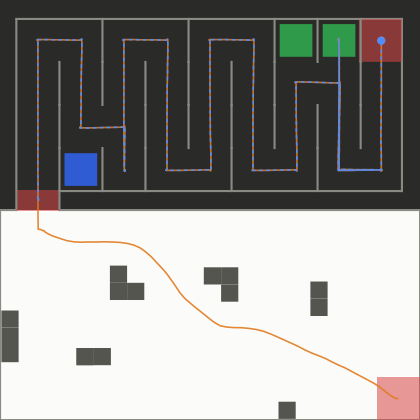 | **D2 · Open hall**<br>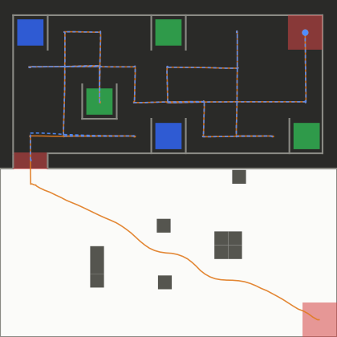 |
|---|---|---|
| **D3 · Comb**<br>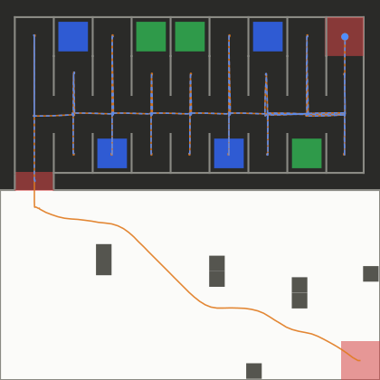 | **D4 · Deep branches**<br>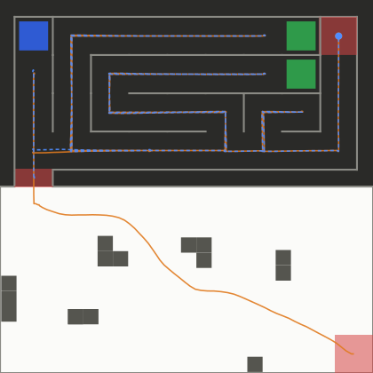 | **D5 · Loops**<br>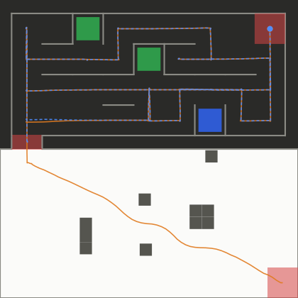 |
| **R1 · Random 1**<br>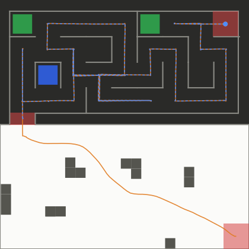 | **R2 · Random 2**<br>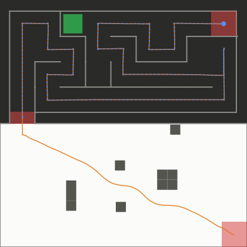 | **R3 · Random 3**<br>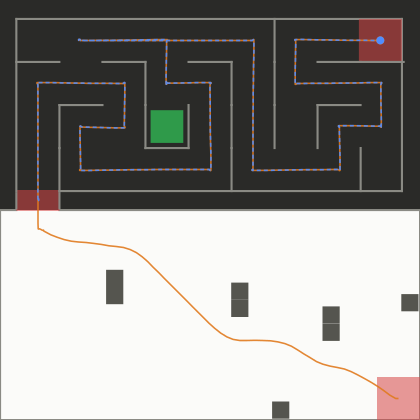 |
| **A1 · Staircase**<br>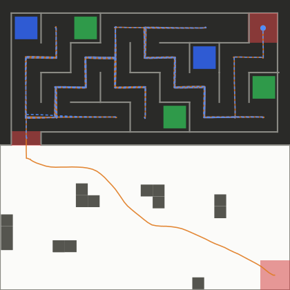 | **A2 · Nine tiles**<br>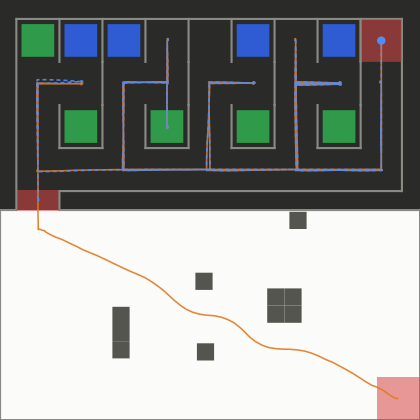 | **A3 · Long corridors**<br>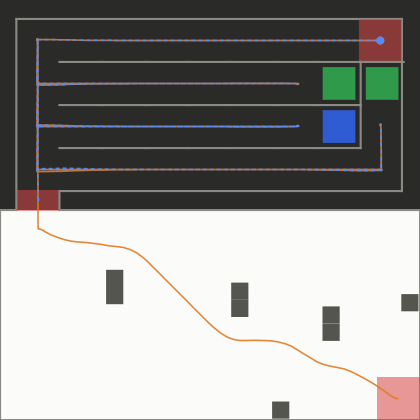 |
| **A4 · Islands**<br>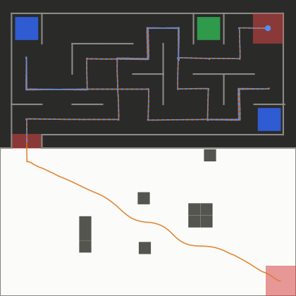 | **A5 · Behind the end**<br>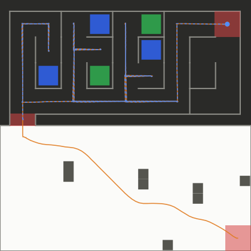 | **A6 · Rooms**<br>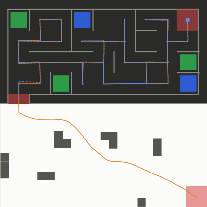 |
| **A7 · Ladder**<br>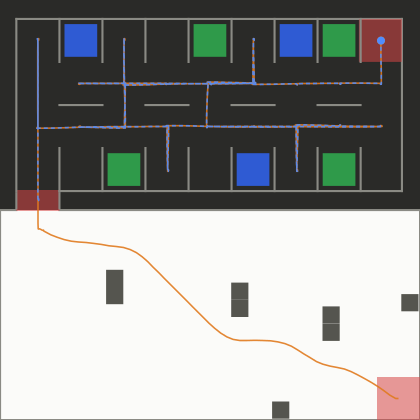 | **A8 · Spiral**<br>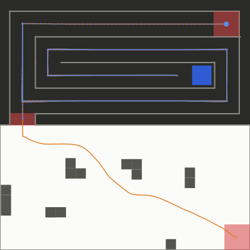 | **A9 · Hard perfect 1**<br>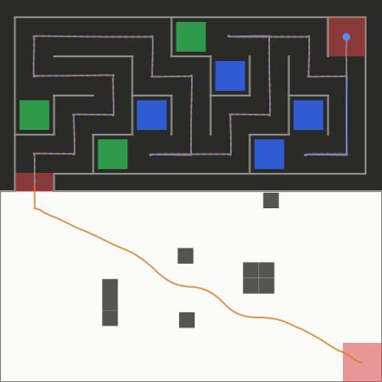 |
| **A10 · Hard perfect 2**<br>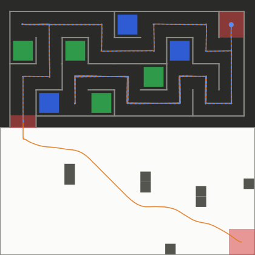 | **A11 · Braided 1**<br>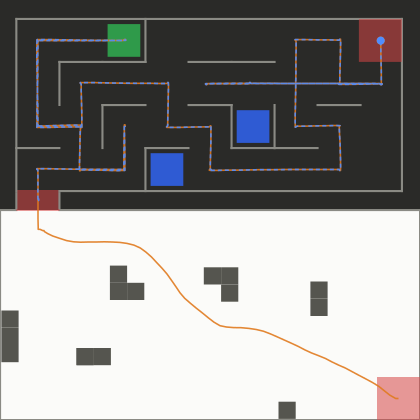 | **A12 · Braided 2**<br>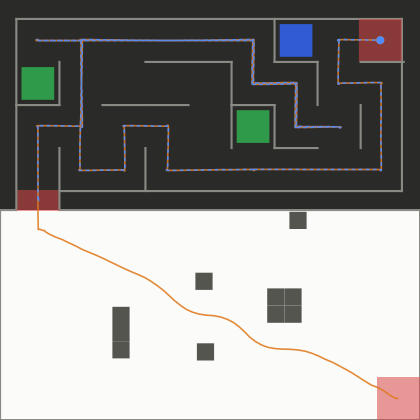 |

## New algorithm vs. previous algorithm

The same 42 worlds and the same judge were run with the previous controller (results in `testing/test_tools/suite_results_old/`).

| | Previous | **New (main)** |
|---|---|---|
| Runs passed | 38 / 42 | **42 / 42** |
| A4 Islands, A7 Ladder | looped until the time limit | finish in 94 s / 108 s |
| Official arena, full run | 169.9 s | **117.1 s** |
| Full runs, 19 arenas both finish | 3163 s | **2310 s (−27 %)** |
| Cell moves, full runs, all 21 arenas | 1328 (incl. looping runs) | **949** |

| Arena | Run | Verdict old → new | Maze time old → new (s) | Cell moves old → new | Re-driven old → new |
|---|---|---|---|---|---|
| OFF Official arena | full | PASS → **PASS** | 148 → **96** | 47 → 39 | 17 → 13 |
| OFF Official arena | Section 2 only | PASS → **PASS** | 148 → **96** | 47 → 39 | 17 → 13 |
| D1 Snake | full | PASS → **PASS** | 125 → **89** | 43 → 41 | 9 → 8 |
| D1 Snake | Section 2 only | PASS → **PASS** | 124 → **89** | 43 → 41 | 9 → 8 |
| D2 Open hall | full | PASS → **PASS** | 109 → **84** | 37 → 37 | 11 → 11 |
| D2 Open hall | Section 2 only | PASS → **PASS** | 110 → **84** | 37 → 37 | 11 → 11 |
| D3 Comb | full | PASS → **PASS** | 187 → **130** | 63 → 55 | 29 → 25 |
| D3 Comb | Section 2 only | PASS → **PASS** | 186 → **130** | 63 → 55 | 29 → 25 |
| D4 Deep branches | full | PASS → **PASS** | 164 → **114** | 63 → 57 | 28 → 25 |
| D4 Deep branches | Section 2 only | PASS → **PASS** | 164 → **114** | 63 → 57 | 28 → 25 |
| D5 Loops | full | PASS → **PASS** | 157 → **94** | 55 → 43 | 24 → 13 |
| D5 Loops | Section 2 only | PASS → **PASS** | 157 → **95** | 55 → 43 | 24 → 13 |
| R1 Random 1 | full | PASS → **PASS** | 134 → **97** | 43 → 41 | 14 → 11 |
| R1 Random 1 | Section 2 only | PASS → **PASS** | 134 → **97** | 43 → 41 | 14 → 11 |
| R2 Random 2 | full | PASS → **PASS** | 102 → **76** | 33 → 33 | 1 → 1 |
| R2 Random 2 | Section 2 only | PASS → **PASS** | 102 → **76** | 33 → 33 | 1 → 1 |
| R3 Random 3 | full | PASS → **PASS** | 113 → **76** | 37 → 33 | 6 → 2 |
| R3 Random 3 | Section 2 only | PASS → **PASS** | 113 → **75** | 37 → 33 | 6 → 2 |
| A1 Staircase | full | PASS → **PASS** | 235 → **159** | 71 → 65 | 39 → 36 |
| A1 Staircase | Section 2 only | PASS → **PASS** | 236 → **159** | 71 → 65 | 39 → 36 |
| A2 Nine tiles | full | PASS → **PASS** | 187 → **129** | 65 → 59 | 35 → 33 |
| A2 Nine tiles | Section 2 only | PASS → **PASS** | 187 → **130** | 65 → 59 | 35 → 33 |
| A3 Long corridors | full | PASS → **PASS** | 156 → **109** | 65 → 59 | 30 → 27 |
| A3 Long corridors | Section 2 only | PASS → **PASS** | 156 → **109** | 65 → 59 | 30 → 27 |
| A4 Islands | full | FAIL → **PASS** | never finished → **94** | 146 → 39 | 137 → 12 |
| A4 Islands | Section 2 only | FAIL → **PASS** | never finished → **94** | 151 → 39 | 142 → 12 |
| A5 Behind the end | full | PASS → **PASS** | 154 → **95** | 53 → 45 | 25 → 21 |
| A5 Behind the end | Section 2 only | PASS → **PASS** | 154 → **96** | 53 → 45 | 25 → 21 |
| A6 Rooms | full | PASS → **PASS** | 150 → **104** | 47 → 43 | 17 → 15 |
| A6 Rooms | Section 2 only | PASS → **PASS** | 150 → **105** | 47 → 43 | 17 → 15 |
| A7 Ladder | full | FAIL → **PASS** | never finished → **108** | 237 → 43 | 224 → 19 |
| A7 Ladder | Section 2 only | FAIL → **PASS** | never finished → **108** | 245 → 43 | 232 → 19 |
| A8 Spiral | full | PASS → **PASS** | 146 → **110** | 63 → 63 | 29 → 29 |
| A8 Spiral | Section 2 only | PASS → **PASS** | 145 → **110** | 63 → 63 | 29 → 29 |
| A9 Hard perfect 1 | full | PASS → **PASS** | 106 → **80** | 33 → 33 | 5 → 5 |
| A9 Hard perfect 1 | Section 2 only | PASS → **PASS** | 107 → **80** | 33 → 33 | 5 → 5 |
| A10 Hard perfect 2 | full | PASS → **PASS** | 133 → **101** | 41 → 41 | 13 → 13 |
| A10 Hard perfect 2 | Section 2 only | PASS → **PASS** | 133 → **101** | 41 → 41 | 13 → 13 |
| A11 Braided 1 | full | PASS → **PASS** | 142 → **94** | 47 → 41 | 17 → 13 |
| A11 Braided 1 | Section 2 only | PASS → **PASS** | 143 → **94** | 47 → 41 | 17 → 13 |
| A12 Braided 2 | full | PASS → **PASS** | 119 → **90** | 39 → 39 | 11 → 11 |
| A12 Braided 2 | Section 2 only | PASS → **PASS** | 119 → **90** | 39 → 39 | 11 → 11 |

### What changed

1. **Commit to the chosen target (fixes livelocks).** `pick_target()` used to re-optimise the whole tour at every stop, but the robot only drives the first straight run of it. Two near-equal tours could therefore alternate forever (A4 Islands, A7 Ladder). Now the target chosen at a stop is kept while it is still unresolved and reachable.
2. **Glance into a dead end beside the robot before leaving.** A known dead end right beside the robot is checked immediately with one turn. Before, it was left for a later come-back that re-drove the same cells (R3: re-driven moves 6 → 2).
3. **Don't drive into a dead end whose tile the camera already saw.** Tiles only lie in dead ends. So a cell where the camera sees a blue or green tile from the neighbouring cell is counted, marked done and sealed: its other sides are recorded as walls, and any planned drive into it is skipped. Before, the robot drove into 37 of the 82 tiles it had already seen. Full runs are 5.7 % faster in total.
4. **Full speed over cells already driven through.** Straight runs of 2+ cells over visited cells use `S2_KNOWN` = 10 rad/s (the motor maximum) instead of 8 rad/s, since there is nothing new to scan there. Full runs are 1.7 % faster in total; A8 Spiral is 9 s faster.
5. **Quicker stops and turns (`motion.py`).** `drive_axis` now brakes at a constant `DRIVE_DECEL` = 0.5 m/s². `turn_to` brakes at `TURN_DECEL` = 15 rad/s² and finishes the last ~10° with `TURN_K_END` = 20. This saves about 1 s at every stop, making the whole suite about 22 % faster, with unchanged end-cell margins and no collisions.

### Known risk

The robot never stands still for long, but in some mazes it drives back over known cells for more than 15 s before reaching a new one. Examples: A8 Spiral 42 s, A10 30 s, A1 25 s, A2 22 s; the official arena peaks at 11 s. These are forced drives back out of long dead-end branches; the spiral's only exit is a 23-cell corridor, which takes at least 29 s at top speed. A judge who reads "no meaningful progress" as stuck, looping or spinning should not count them.

---

# Running the tests

Requirements: Webots R2025a and Python 3. Set `WEBOTS_EXE` if Webots isn't at the default path in `run_advanced.py`.

1. Give the test project the controller under test. `testing/test_run/controllers/` needs a `main_controller` folder. Link it to the real one so you always test the live code (run in an normal shell; a Windows junction needs no admin rights):
   ```bash
   # Git Bash on Windows
   cmd //c mklink /J testing\\test_run\\controllers\\main_controller controllers\\main_controller
   # Linux / macOS
   ln -s ../../../controllers/main_controller testing/test_run/controllers/main_controller
   ```
2. Run the suite (the Webots window is shown, one run at a time):
   ```bash
   cd testing/test_tools
   python run_advanced.py --out video_results --mode fast $(ls ../test_run/worlds/test_j_*.wbt | grep -v ORIG)
   #   --movie videos      also record an MP4 of every run
   #   --headless -j 4     no window, 4 runs in parallel (much quicker)
   ```
3. Build the report and drawings:
   ```bash
   python make_report.py --suite --results video_results     # REPORT.md + report.html, with the old-vs-new comparison
   python export_svgs.py                                     # docs/paths/*.svg
   ```

Other tools: `gen_suite.py`, `gen_advanced_worlds.py`, `gen_design_worlds.py` and `gen_random_world.py` generate test arenas. `maze_sim.py` and `offline_designs.py` run the exploration logic offline on random mazes (400 / 400 correct).
